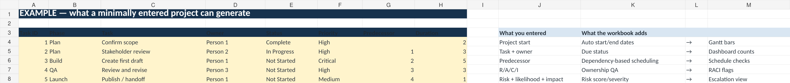

# Automated Project Management Control Center

A formula-first project-management workbook designed to reduce manual maintenance while keeping project logic visible.

*Preview: a minimally entered synthetic project and the outputs the workbook is designed to generate.*

## Prepared artifact

[Download the Excel workbook](Automated_Project_Management_Control_Center.xlsx)

## What it supports

- task and milestone planning;
- predecessor-based scheduling;
- dynamic Gantt views;
- RACI assignment and quality checks;
- risk and issue tracking;
- project-health reporting;
- clearly separated INPUT, AUTO, OPTIONAL, and ACTION NEEDED fields.

## Design approach

The workbook is built around **minimum input, maximum useful output**. Automation handles repetitive calculations and schedule propagation, while ownership, judgment, and escalation remain visible to the user.

## Public-use standard

The public version uses generic/sample content and contains no employer, client, learner, or proprietary source data.

## Browser-based RAID and decision register

[Open or download the standalone HTML source](raid-decision-log.html) to maintain a small-project register of risks, assumptions, issues, dependencies, and decisions. Assign owners and review dates, calculate a simple ordinal risk priority, flag overdue actions, filter the register, and export CSV or JSON. The tool requires no login and sends no project data to a service.

Use the workbook for schedules and cross-project reporting; use the register for context, rationale, ownership, and decision history. Risk scores are discussion aids, not quantitative probability estimates.

[Back to Tools & Templates](../README.md)
